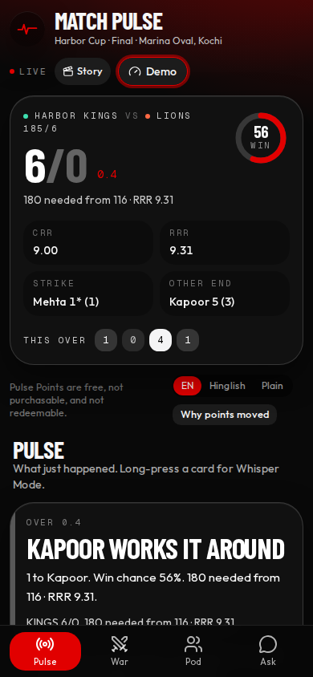
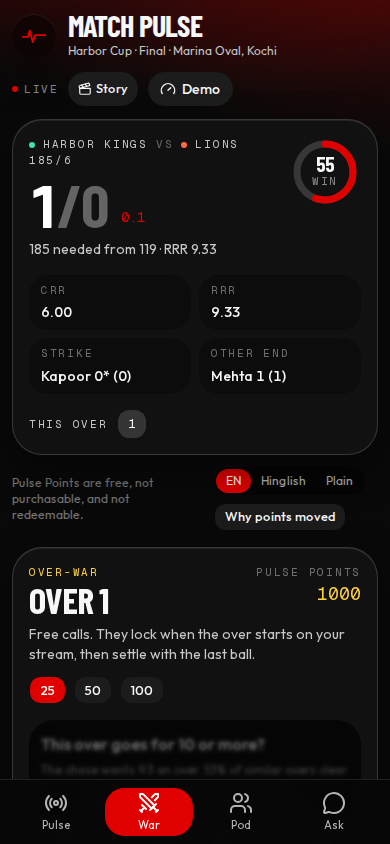
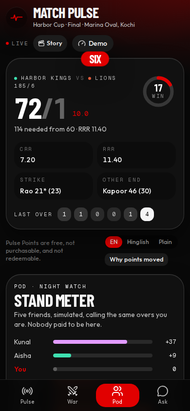
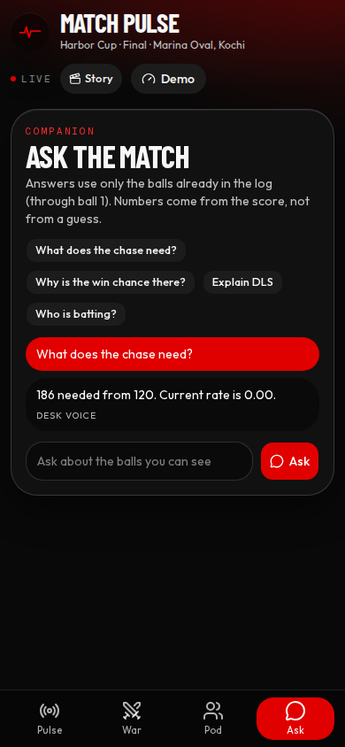
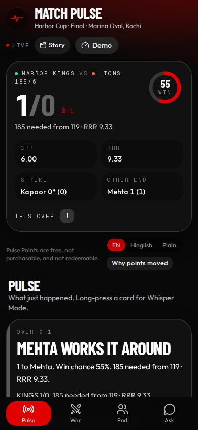
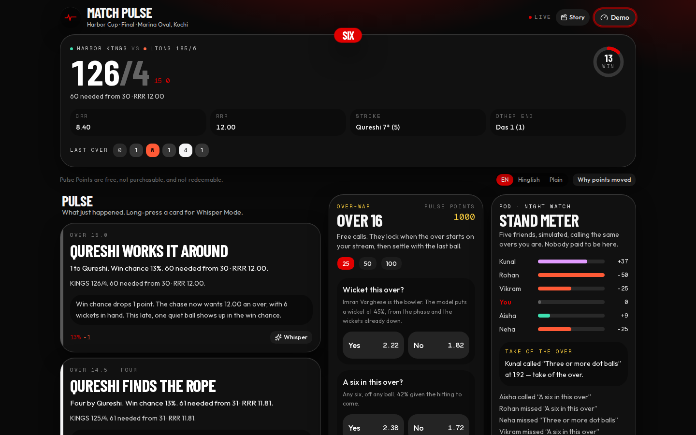
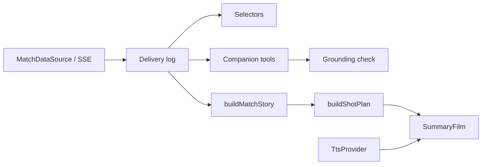

# Match Pulse

A live second screen for a T20 chase. Balls land in order. You call the over, ask the match, and leave with a story.

Moment cards, win-chance swings, and Over-War calls follow the delivery log as it arrives. Before each over you and a private pod stake **Pulse Points** — free, not purchasable, not redeemable — on two or three micro-calls. The companion answers from that same log. At the whistle it becomes a 9:16 Match Story you can save or share.

This is a frontend-shaped product for a Dream11 Forward Deployment Engineer exercise. It is not Dream11, and it does not use their marks.



## Run it

```bash
npm install
npm run dev
```

Open [http://127.0.0.1:43123](http://127.0.0.1:43123). No API key is required. The whole chase is a recorded Harbor Cup final (fictional sides) played by a match engine.

```bash
npm test          # Vitest: scoring, markets, reorder, grounding, story, feed session
npm run typecheck
npm run lint
npm run test:e2e  # Playwright, phone-sized, needs the dev server or starts one
npm run studio    # Remotion Studio for MatchStory on port 43223
npm run render:story  # MP4 of the fixture story, written to artifacts/match-story.mp4
```

Optional copy upgrade: copy `.env.example` to `.env.local` and set `OPENAI_API_KEY` or `AI_GATEWAY_API_KEY`. Keys stay on the server. If the model is absent, slow, or unsafe, the desk voice is what you see.

## Demo script, about three minutes

1. Open **Demo** and press **5×**. The innings runs in about three minutes. Cards appear as each ball arrives. The break before each over stays long enough to call, even at 20×.
2. Open **Over-War**. Stake 25. Tap Yes or No. The call locks when the over starts and settles when it ends. A correct call toasts the points.
3. Open **Pod**. Aisha, Rohan, Neha, Vikram, and Kunal are simulated friends with stable habits. The stand meter is this over. "Take of the over" is the sharpest correct call.
4. Long-press a card, or tap **Whisper**, for the plain-language version. Switch **EN / Hinglish / Plain** for the commentary line.
5. **Why points moved** reads a sample Flex XI. A six by the captain is 6 runs + 2 bonus, doubled, in one sentence.
6. Open **Ask**. Try "What does the chase need?" or "Explain DLS". The answer quotes only numbers already in the log.
7. In Demo, **Drop link** kills the socket for 2.5s and backfills. **Jitter** swaps two balls; they still apply in order. **Jump** to over 16 resets points so the arc stays fair.
8. Tap **Story**. Step through the 9:16 cards. **Video** records a WebM, **PNG** saves a card, **Share** uses the device share sheet or copies the text.
9. **Match Summary** builds a pencil-sketch film of the loaded match, with a voiceover. Switch the match menu to the Wellington scorecard to hear a finished ODI. espeak-ng speaks it when it is on the machine. **Download** renders an MP4 on Node.

## Screens

Mobile pulse, live as the balls arrive:


Over-War, open before the over starts:



The pod, mid-chase:



Ask the companion. This answer is the desk voice, using only balls already in the log:



The Match Story, 9:16, from the same log:



Desktop is the same match as a broadcast desk: feed, the call, the room.



## How it is put together



The domain is plain TypeScript. React, the model, and speech sit behind ports. Numbers on screen come from the log or the scorecard, not from the model.

## Environment

Copy `.env.example` to `.env.local`. Every variable is optional.

| Variable | Used for |
| --- | --- |
| `OPENAI_API_KEY` | Companion, commentary, and speech if espeak is absent |
| `OPENAI_MODEL` | Defaults to `gpt-4o-mini` |
| `AI_GATEWAY_API_KEY` | Same calls through the Vercel AI Gateway |
| `MATCH_PULSE_MODEL` | Gateway model id |
| `NVIDIA_API_KEY` | Optional rewrite of anime shot prompts |
| `HF_TOKEN` | Reserved. The video port does not call out yet |
| `CRICAPI_KEY` | CricketData.org fallback. Server only. Free tier is 100 hits a day |

Speech with no key: install `espeak-ng`. Match Summary still plays with captions if neither espeak nor an OpenAI key is present.

Live scores try Cricbuzz first (unofficial, polled on the server), then CricAPI if `CRICAPI_KEY` is set, then the recorded demo. The badge says which source is on screen.

## Where to read

- [Product rationale](docs/PRODUCT_RATIONALE.md) — the post-2025 Dream11 context, the fan problems and the links, what was left out, the compliance note, the metrics we would treat as hypotheses.
- [Architecture](docs/ARCHITECTURE.md) — layer diagram, delay buffer, reconnect and reorder, ADRs, how this fans out to a million concurrent devices.
- [Submission note](docs/SUBMISSION_NOTE.md) — under 200 words, with the count.

## What the innings is

Harbor Kings chase 186 against Ridge Lions at Marina Oval, Kochi. Twenty overs, a powerplay, a wobble, a finish. Players are fictional. The win-chance number is a small logistic model of runs still expected versus runs still needed. It is not a price.
