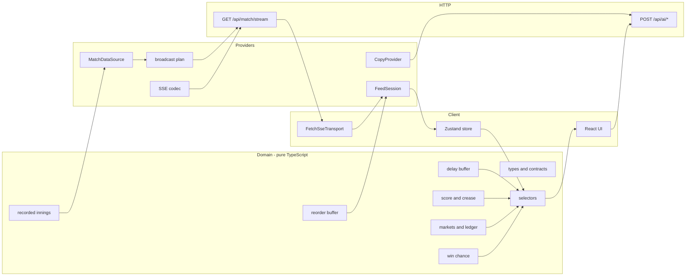
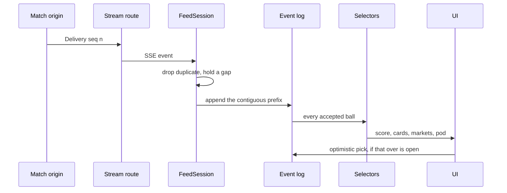
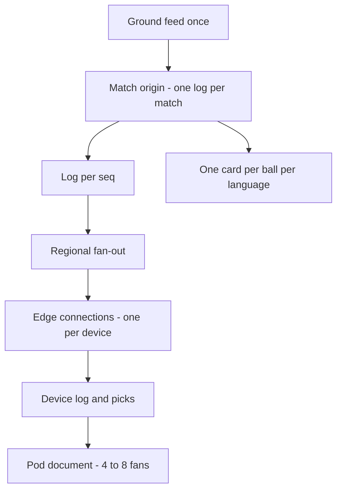
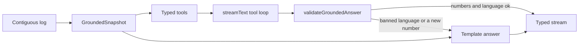
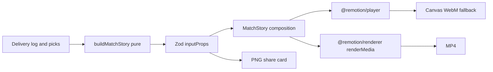

# Architecture

Match Pulse is a second screen. The ground feed is the same for every fan. The only thing that is theirs is how late their picture is, and what they called. The code is arranged so those two facts stay separate, and so the cricket rules can be tested without React, a socket, or a model.

## Layers

Dependencies point inward. `src/domain` imports nothing from React, Next.js, Zustand, or the AI SDK. Providers implement ports. The store calls pure selectors. Components render a view model and send intents back.

| Path | Owns | Must not |
| --- | --- | --- |
| `src/domain` | Types, the innings compiler, scoring, win chance, markets, the ledger, fantasy points, card copy, the delay buffer, the reorder buffer, selectors | `fetch`, JSX, env vars |
| `src/providers/match` | Turning a `MatchDataSource` into a timed plan, framing SSE, the client session | Deciding if a call won |
| `src/providers/ai` | `CopyProvider`, the companion tool loop, commentary. Template desk voice, or the AI SDK when a key exists | Inventing odds, resolving a market, or quoting a number the log does not contain |
| `src/app/api` | HTTP. Reads the request, calls a provider, writes bytes | Cricket rules |
| `src/state` | The session log, picks, playback, and the cached view | Scoring math |
| `src/components` | Layout, motion, accessibility | When an over locks |

A live vendor feed replaces `FixtureSource`. A different model replaces `createModelProvider`. The UI does not change.

## Data flow

The log is append-only and ordered by `seq`. A ball enters it only after the session has the contiguous prefix, so the UI never shows ball 12 before ball 11. Score, win chance, cards, market phase, the ledger, bot picks, and the pod are functions of `(deliveries, picks)`. Recomputing them cannot double-pay a win.

## Decisions

### ADR 1 — Event-sourced timeline, not a mutable scoreboard

**Decision.** The source of truth is the delivery log. `foldDeliveries` / `applyDelivery` rebuild the score. `projectInnings` rebuilds cards and the win-chance series in one pass.

**Alternative.** A mutable `score` object updated inside the React tree, with cards stored beside it.

**Why not.** A second copy of the score in React would drift from the rules the moment a seek or a reconnect replayed the log. Derived state has one implementation, and the tests run it on a prefix and on the full innings.

**Trade-off.** A full fold of 120 balls is trivial. At a full Test match we would keep a checkpoint every over. The fold is still the contract.

### ADR 2 — The visible match is the contiguous log

**Decision.** Once `FeedSession` accepts a delivery, it is part of the match. Selectors fold that array. There is no second clock and no hold-back buffer.

**Alternative.** A per-device delay that hides balls until a fan's video stream catches up.

**Why not.** It split the product into two timelines and made every screen explain what it was hiding. The feed now shows the live state as balls arrive, in order.

**Trade-off.** A fast ground feed can still run ahead of a lagging video. That is the broadcaster's delay, not something Match Pulse conceals. Reorder still refuses to paint an out-of-order ball.

### ADR 3 — Reorder, idempotency, and reconnect live in the session

**Decision.** `FeedSession` is the only thing that talks to the transport. It parses SSE incrementally (`consumeSse` keeps a tail), pushes each delivery through `pushReorder`, and emits only the contiguous prefix. Duplicates (`seq < next`, or a seq already queued) are ignored. A gap arms a short timer and then reconnects with `afterSeq = last contiguous seq`. A dropped socket uses the same cursor, with backoff capped at 4s and a stop after 8 failures. `drop()` is the reviewer's "kill the socket" button: pause, wait, resume, backfill.

**Alternative.** Let the browser's `EventSource` reconnect by itself.

**Why not.** `EventSource` retries the original URL, so it would replay from seq 0 or miss the cursor. It also hides the gap. A `fetch` stream plus an abortable session makes the cursor, the jitter demo, pause, and seek the same code path. Tests drive it with a fake async iterable. No browser.

**Trade-off.** We reimplement a small piece of SSE. The codec is twenty lines and has its own test, including a chunk split mid-event.

### ADR 4 — The model may only rewrite language

**Decision.** `CopyProvider` has two implementations. `createTemplateProvider` calls `renderMoment`, the same function the client uses for instant cards. `createModelProvider` is chosen when `AI_GATEWAY_API_KEY` or `OPENAI_API_KEY` is set. It calls the AI SDK's `generateText` with `Output.object`. The route is server-only. If the model errors, times out, or fails `copyIsSafe` (length, and a ban on bet / cash / wager / DreamBucks), the desk voice is returned instead.

Market *kinds*, probabilities, and odds are computed in `proposeMarkets` before any model sees them. The model may rewrite `prompt` and `detail`. Resolution is `resolveMarket` over the balls. A model cannot talk a fan into a result that did not happen.

**Alternative.** Ask the model for the markets, the odds, and the copy in one call.

**Why not.** The demo would depend on a key, the odds would be untestable, and a fluent hallucination would be a compliance problem.

**Trade-off.** Template copy is less surprising than a model, and that is what reviewers see with no key. The template is situation-specific (the batter, the equation, the swing), not lorem.

### ADR 5 — Picks are client-authoritative in the demo, derived in the ledger

**Decision.** `placePick` checks `canStake` against the view (phase open on the log, stake in {25, 50, 100}, funds, one pick per market) and appends the pick. `projectLedger` always starts from 1,000 and replays every pick against the deliveries. There is no "add the payout" mutation to get wrong on a seek.

**Alternative.** POST the pick to the origin, which stores it.

**Production shape.** The origin would accept a pick until `overStartGroundTime - userDelay`, keyed by user and market, idempotently. The demo does not pretend to have that clock: the delay lives on the device, and the assignment's compliance risk is the currency, which is enforced in the UI and the stake type. The ledger function is the one we would run on the server.

**Trade-off.** A modified client can pick after the lock. That is acceptable in a local demo and not acceptable in production. The phase check is still the same function.

### ADR 6 — Zustand for the session, selectors for the meaning

**Decision.** The store holds the log, picks, playback, and a cached `MatchView`. The view recomputes when a ball is appended or a pick changes. Speed, jitter, and seek are intents the `FeedSession` observes.

**Alternative.** A single `useReducer` in context, or putting the view in React state.

**Why this.** The session callback must update state outside React (`onDelivery` from a socket). Zustand's `getState` does that without a ref dance. The view object is the subscription grain, so a new ball rebuilds one derived snapshot instead of scattering setters through the tree.

**Trade-off.** The store is a module singleton. Tests never need it: they call `selectMatchView` with a fixture. A future SSR of the live match would construct the store per request. Today the page shell is server-rendered and the match is a client island, which is the right cut for a clock.

### ADR 7 — One recorded innings, paced in real time

**Decision.** `planBroadcast` walks `MatchDataSource.deliveries()`. Inside an over, balls are `3800 / speed` ms apart. The first ball of each later over waits `max(4200, 8000 / speed)` ms. That gap is the pick window, and it does not shrink to nothing at 20×. Seek sends history up to `burstUntilSeq` at 12ms a ball, stamped as catch-up. Jitter swaps one pair (`seq % 17 === 8`, never the first ball of an over) so the reorder buffer has something to do.

At 5× the scripted chase is about three minutes. At 1× it is a sitting.

**Alternative.** A wall-clock server that all reviewers share.

**Why not.** Two reviewers would fight over the over break. A stateless route plus a cursor is also what survives a serverless timeout: `maxDuration` is 300 seconds, and a reconnect continues from `afterSeq`.

## Real-time behavior, condensed

| Fault | What the fan sees | What the code does |
| --- | --- | --- |
| Duplicate event | Nothing | `pushReorder` returns `duplicate` |
| Seq n+1 before n | The feed waits, then both land in order | Gap queued; flushed when n arrives |
| Gap never filled | "Backfilling from the last ball" | Reconnect with the contiguous cursor; the origin resends |
| Socket dies | Reconnecting, then the missed balls append in order | Backoff, same cursor, the log grows only at the contiguous edge |
| Seek to over 16 | Score jumps, points reset | `generation` bumps, log cleared, burst stamp |
| Pause | Broadcast held | Abort the stream, do not advance the cursor |

Bot picks are not on the wire. They are a pure function of `(markets, over, member id)` via a seeded generator, so a rewind shows the same friends making the same calls.

## Accessibility and performance

- The score has its own region. A polite live region announces wicket changes, the end of an over, and large jumps in the held count. It does not speak every single.
- Over-War answers are buttons with `aria-pressed`. The stake is a group. Sheets have titles. A skip link points at the feed.
- The delayed timeline is text, not color alone: chips say `W`, `6`, `4`; results say In or Miss.
- `prefers-reduced-motion` zeroes CSS animation, and Framer Motion's `useReducedMotion` skips the number ticker, the stand-meter spring, and the six/wicket sting.
- The view recomputes when the released count changes, not on every animation frame. Cards use `content-visibility: auto`. The reviewer dock is a small client island; the match rules are not in a barrel file that would pull the fixture into the browser. The fixture is imported by the route.
- Whisper and the model round-trip are optional. Cards render from the template in the same turn the ball is released.

## Testing

Vitest covers the domain and the providers without a browser:

- The compiled chase is a win, the planned wickets fall, and no bowler bowls consecutive overs.
- The selector scores every ball in the log, including a wicket the moment it is appended.
- Reorder flushes an inverted pair and ignores duplicates.
- Win chance starts near a coin flip for a par total, falls on a wicket, and is 1 or 0 at the end.
- Odds never sit below 1.25. An open over locks on the first ball and settles on the sixth. The ledger pays once and pays the same number if you run it twice.
- A captain's six is 6 runs + 2 bonus, doubled. A duck is docked. A run-out does not pay the bowler.
- Wicket copy names the idea of a wicket and contains no betting language.
- A held wicket is absent from the score, the feed, and the fantasy line.
- The SSE codec reassembles a split chunk. The broadcast plan keeps order, inserts the over break, and really does swap a pair when jitter is on.
- `FeedSession` emits the swapped pair in order and backfills a gap from the last contiguous ball.

Playwright, on a phone-sized viewport, waits until the feed is live, starts the 5× arc, sees a moment card, opens Over-War, and finds the pod. That is the path a reviewer walks.

## Scaling this to millions of concurrent fans

The demo terminates one SSE response per browser, from a stateless function that sleeps between balls. That is the right shape to *test*. It is the wrong shape at the size of an IPL innings.

- **Fan out the match, not the user.** One producer writes the delivery log. A regional tier subscribes once and holds the connections. The bytes are identical for every fan; the delay is applied on the device. A CDN can cache the recorded demo. A live match is not cacheable, but a ball is under a kilobyte every few seconds, which is a boring amount of bandwidth.
- **Connections are idle.** The cost is file descriptors and heartbeats, not CPU. The origin must not be the thing holding a million sockets. `maxDuration` plus a cursor is the same idea at small scale: the function can die, the client resumes.
- **Personal state is small and keyed.** Delay, picks, and the pod id are a document per `(user, match)`, written when a pick is placed, not on every ball. The authorization check is `now < overStart - delay`. Any replica can evaluate it. No sticky session.
- **Copy is computed once.** The model runs per ball per language, behind the same cache key, not per viewer. The template is the stale-while-revalidate fallback.
- **Pods do not need a global leaderboard.** Four to eight friends is a document and a tiny pub/sub channel. The "take of the over" is a max over that document. A million pods is a million small keys, which is a normal datastore problem, not a sorted-set hotspot.
- **Rules stay pure.** Score, win chance, and settlement move with the log. A new region recomputes; it does not replicate a mutable scoreboard.
- **What we would not do.** Per-user streams from the origin. Generating copy on the device. Letting the model decide the result. Putting Pulse Points on a ledger that can be exchanged for DreamBucks.

## AI grounding

The companion is grounded in the log, not in a hidden buffer. `POST /api/ai/companion` takes `seenThroughSeq`, the latest contiguous delivery the client has accepted. The server slices `MatchDataSource` at that seq and builds a `GroundedSnapshot` in `src/domain/grounding.ts`. Tools (`getScore`, `getRequiredRate`, `getWinProbability`, `getPlayer`, `getRecentOvers`, `explainTerm`) close over that snapshot. They cannot read a later delivery.

`validateGroundedAnswer` rejects betting language and any numeral that is not in the snapshot. The model call uses `streamText` with `stopWhen: isStepCount(4)` so it can call tools and then speak. The bytes are buffered until the check passes, then written as a short text stream so a bad number never paints. With no `OPENAI_API_KEY` or `AI_GATEWAY_API_KEY`, the same template answer streams. Commentary (`english`, `hinglish`, `plain`) is the same rule on one ball: `renderCommentary` for the desk voice, the model only if the line survives the same check.

The gap between balls in the SSE plan (`leadInMs`) is playback pacing for the demo, not a per-fan hold. A 5× review still gets a real pause before each over so a call can be placed.

## Match Story

`buildMatchStory` stays pure. It returns beats plus the win-chance series, calls, pod lines, MVP, and final score. `matchStorySchema` is the Remotion `inputProps` contract, and a unit test parses the fixture through it.

`MatchStory` is a 1080×1920, 30fps composition: title, an animated win-chance chart, Over-War calls, pod lines, MVP, final score, and a branded outro. Scenes are `Sequence`s. Motion uses `spring` and `interpolate`. Captions use the `@remotion/captions` `Caption` type. A short sting plays from `public/story-hit.wav` through `<Audio>`.

The in-app screen previews that composition with `@remotion/player`. If the player throws, the previous card stepper remains. Export prefers a Node route that calls `renderMedia` and reports progress. That route needs a long-lived Node process, not a serverless isolate, so the browser WebM recorder stays as the fallback. PNG and the Web Share API are unchanged.

`IntroClipProvider` is the slot for a later Hugging Face video intro (`HF_TOKEN`). The placeholder and the HF stub return null and can cache a URL. The composition only mounts `OffthreadVideo` when `introClipUrl` is set. The pure generator always leaves that field null.

### AI video prompting

Anime clips are not freehand prompts. `buildShotPlan` reads the story beats and keeps at most six shots, 2–4 seconds each, one per event (spell, lone block, collapse, partnership, rain, celebration, and the rest of the typed table). Each shot stores the beat id and the sourced fact. The fact is not copied into the prompt.

`layeredPromptSchema` is the contract: a global style block, a global world block (venue, time, and weather taken from the beats), a global character sheet (blue kit and black kit, roles only), then per shot an action from a typed event table, a camera from that same table, and a mood from `max(tension, swing)`. Tension is read from the beat: wickets, a wicket cluster, the asking rate, a rain or DLS stoppage, and the result margin. It is capped below the celebration band. The lighting table is calm overcast, then brooding storm light, then electric rim light for a celebration or a real swing. The constraints block bans text, logos, real faces, numbers, and baseball gear, and it forbids an event the action does not name. A six is depicted only when the beat is a six. `renderPrompt` and `negativePrompt` are deterministic.

An optional director (`OPENAI_API_KEY`, `AI_GATEWAY_API_KEY`, or `NVIDIA_API_KEY`) may rewrite wording inside those blocks. `acceptRewrite` drops the rewrite if the event changes, the verb stem disappears, or a player name, logo, or betting term appears. The template is the fallback.

`VideoGenProvider.generate` returns a clip URL cached by a hash of the rendered prompt. The placeholder and the Hugging Face stub (`HF_TOKEN`) do not call a network. Remotion plays a clip only when the URL is http(s) or a site path, muted, with the beat's stat drawn by Remotion on top. On a beat-by-beat reel the clip sits in front of its card. On the default reel the clips play as a montage before the title.

Match Summary is the one-click film. `buildMatchSummary` runs `buildMatchStory` and `buildShotPlan` for whichever match is loaded, maps each shot to a pencil scene, and writes a narration line that must pass `validateGroundedAnswer`. `TtsProvider` speaks it: espeak when the binary is installed, OpenAI TTS when a key is set and espeak is not, otherwise silence with the captions still on screen. Scene length follows the spoken wav. The Remotion `SummaryFilm` composition draws the stick figures and mixes the audio, so the in-app Player and a Node `renderMedia` download are the same film. Serverless hosts cannot run that render; the Player is the summary there. A second click is instant because the film is cached on the match id and the last ball received.

## Live sources

The recorded Harbor innings is still a `MatchDataSource`. A live match is another implementation of that same port. Selectors, the companion, Match Story, and Match Summary read the delivery log and do not know which adapter filled it.

Order is Cricbuzz, then CricAPI, then the demo fixtures. One shared poller per match serves every SSE client from the cache. Cricbuzz is polled every 15–30 seconds while a match is in progress, with backoff, a browser user-agent, and an 8 second timeout. CricAPI is not called while Cricbuzz is healthy. When it is the source, remaining free-tier hits (100 a day, 4 held back) are spread across a four-hour live window, about 150 seconds when the score is moving and slower when it is not, on a break, or once the quota is spent.

Cricbuzz's current site is a Next.js app. The old CSS classes a BeautifulSoup scraper used are gone. The live list and the match page embed the JSON the page itself renders, including `matchCommentary` with ball text, events, and `ballMetric`. We parse that. Recent commentary becomes real deliveries. Runs and wickets that happened before that window become one scoreboard passage (`feed: "scoreboard"`, `boardSpan` greater than 1) so the summed log matches the scoreboard without inventing the missing shots. If that payload is missing, the poller logs the failure and tries CricAPI's `currentMatches` score lines the same way: deltas, marked as over summaries. If both fail, the demo fixtures stay in the picker and the screen keeps the last good log, or the Harbor chase, with a note.

This is an unofficial read of Cricbuzz. Their markup can change, a datacenter IP can be blocked, and their terms restrict automated access. The port is the point: a licensed feed replaces `CricbuzzDataSource` without touching the domain. CricAPI is the licensed-shaped fallback already wired (`CRICAPI_KEY`, server only). It is score-level and about a minute behind. Ball-by-ball there is paid, so we do not depend on it.

## What is deliberately thin

The pod is five seeded bots plus you. There is no account. The fantasy XI is a sample, not *your* team. Economy and strike-rate bands update at the end of an over. Extras are in the type and the reducer (a wide is tested) and absent from this particular innings, so the story stays a legal ball at a time. None of those are load-bearing. The ports around them are.
